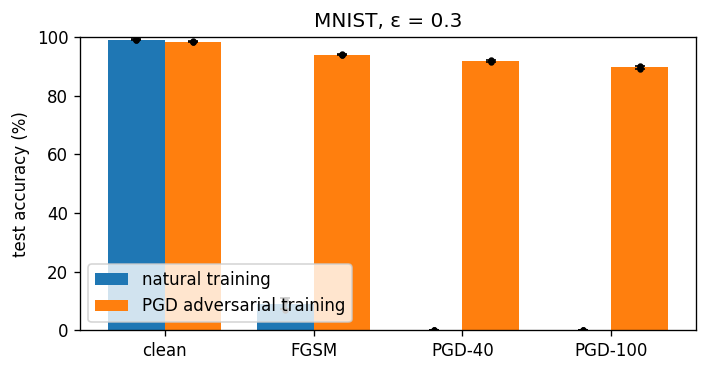
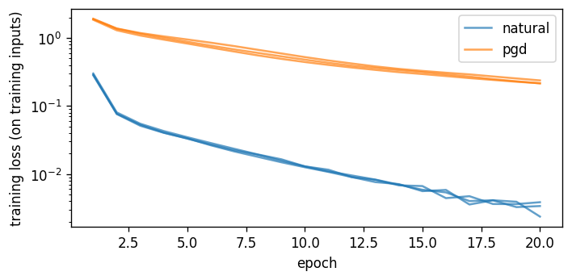
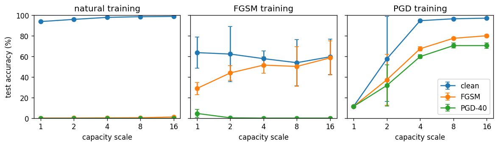
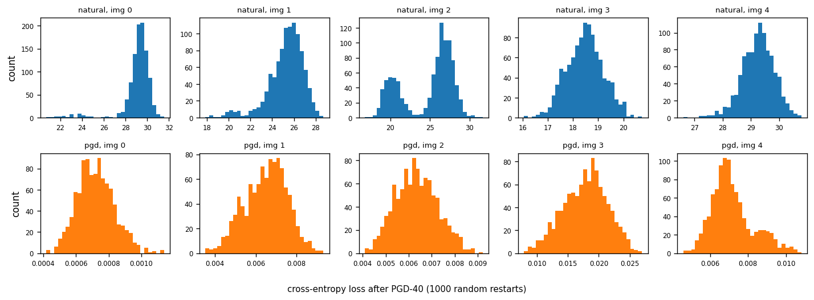
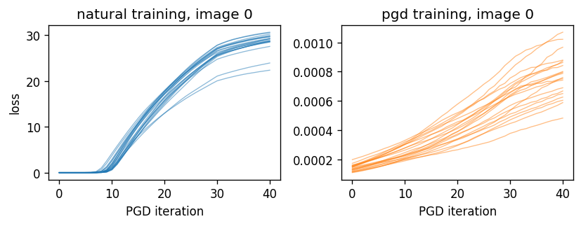
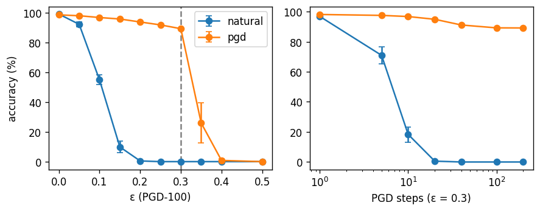

# Reproducing Madry et al. (ICLR 2018) on MNIST

CMP4509 Deep Learning, Fall 2026 term project.

We reproduce the central MNIST result of *Towards Deep Learning Models Resistant to Adversarial Attacks* (Madry, Makelov, Schmidt, Tsipras, Vladu, ICLR 2018) in PyTorch on a free Google Colab GPU. The paper trains networks on adversarial examples found by projected gradient descent (PGD), which approximately solves the saddle-point problem

$$\min_\theta \; \mathbb{E}_{(x,y)}\Big[\max_{\|\delta\|_\infty \le \varepsilon} L(\theta, x+\delta, y)\Big].$$

**Summary.** The central claim holds in our setting. Our PGD-trained network keeps **87.8–91.8%** accuracy under ℓ∞ attacks with ε = 0.3, while a normally trained network drops to **0%** (paper: 89.3–93.2%). We also reproduce three supporting findings of the paper:
- robustness needs network capacity;
- PGD losses from random restarts are concentrated;
- the robustness is not caused by gradient masking.

The remaining 1–2 point gap is consistent with our ~4× shorter training.

---

## Results

All numbers are test accuracy in %. Unless marked otherwise they are mean ± sample standard deviation (ddof = 1) over seeds 0, 1 and 2, and the final model is used (no checkpoint selection).

### E1 — Central claim: PGD adversarial training (paper Table 1)

Full network (conv 32 → conv 64 → fc 1024 → fc 10, 3.27 M parameters), 20 epochs.

| Attack | Steps | Restarts | Natural training | PGD training (ours) | Paper |
|---|---|---|---|---|---|
| none (clean) | – | – | 99.09 ± 0.09 | 98.43 ± 0.09 | 98.8 |
| FGSM | 1 | 1 | 9.04 ± 1.91 | 93.98 ± 0.24 | 95.6 |
| PGD | 40 | 1 | 0.00 ± 0.00 | 91.84 ± 0.34 | 93.2 |
| PGD | 100 | 1 | 0.00 ± 0.00 | 89.60 ± 0.42 | 91.8 |
| PGD* | 40 | 20 | 0.00 ± 0.00 | 89.47 ± 0.23 | 90.4 |
| PGD* | 100 | 20 | 0.00 ± 0.00 | 87.83 ± 0.21 | 89.3 |
| Transfer (black-box), PGD-100 | 100 | 1 | 0.03 ± 0.04 | 95.26 ± 0.26 | 95.4–97.0 |

\* first 1000 test images; all other rows use the full 10,000-image test set.

- **Natural model:** 99% clean accuracy but 0% under every PGD attack.
- **PGD-trained model:** gives up 0.7 points of clean accuracy and keeps about 88–92% under attack.
- **Seeds:** all three agree closely (std < 0.5) and no run collapsed.
- **Gap to the paper:** our training loss was still decreasing at epoch 20.

### E2 — Capacity (paper Section 4, Figure 4)

Network widths scaled by s: conv(2s) → conv(4s) → fc(64s); s = 16 is the paper's network. 5 epochs, 3 seeds per cell, PGD-40 accuracy shown.

| Training | s = 1 (13.5k) | s = 2 (52.5k) | s = 4 (207k) | s = 8 (822k) | s = 16 (3.27M) |
|---|---|---|---|---|---|
| Natural | 0.00 | 0.00 | 0.00 | 0.00 | 0.00 |
| FGSM | 4.51 ± 3.85 | 0.27 ± 0.47 | 0.00 | 0.00 | 0.00 |
| PGD | 11.35 (all 3 seeds collapsed) | 32.8 / 11.4 / 51.0 (per seed; 1 collapsed) | 59.77 ± 1.68 | 70.41 ± 2.44 | 70.43 ± 2.79 |

Clean accuracy of the same models:

| Training | s = 1 | s = 2 | s = 4 | s = 8 | s = 16 |
|---|---|---|---|---|---|
| Natural | 93.77 ± 0.62 | 95.88 ± 0.42 | 97.83 ± 0.19 | 98.50 ± 0.19 | 98.79 ± 0.22 |
| FGSM | 63.60 ± 15.04 | 62.20 ± 26.78 | 57.72 ± 7.40 | 53.84 ± 22.47 | 59.56 ± 16.99 |
| PGD | 11.35 | 70.5 / 11.4 / 90.8 | 94.63 ± 0.67 | 96.47 ± 0.19 | 97.07 ± 0.10 |

- **Small networks collapse under PGD training.**
  - At scale 1 every seed predicts a single class for every input.
  - Its accuracy, 11.35%, is exactly the share of digit "1" in the test set (1135 / 10,000).
  - Its training loss stays at ln 10 ≈ 2.30, the loss of a uniform prediction over 10 classes.
- **Robustness grows with capacity:** about 32 → 60 → 70%. Scales 8 and 16 are equal only because of the 5-epoch budget; the scale-16 network reaches 91.8% after 20 epochs (E1).
- **FGSM training gives no robustness against PGD.** FGSM-trained models also have low and unstable clean accuracy. The paper reports the same: with large ε, FGSM training overfits to FGSM examples ("label leaking").

For scale 2 PGD we report seeds individually, because a mean ± std over one collapsed and two working seeds (57.6 ± 41.3) would be misleading.

### E3 — Loss concentration over random restarts (paper Figures 1–2)

For 5 test images we ran PGD-40 from 1000 independent random starts each, on the seed-0 models.

| Model | Mean final loss | Mean within-image std | Max over 5000 runs |
|---|---|---|---|
| Natural | 25.37 | 1.52 | 31.65 |
| PGD-trained | 0.008 | 0.0013 | 0.027 |

- For each image the 1000 final losses lie in a narrow range with no outliers. PGD finds local maxima of very similar quality, which is why it is a good inner maximiser for training.
- On the robust model even the worst of 5000 runs leaves probability e^(−0.027) ≈ 0.97 on the correct class, so no restart found an adversarial example.

### E4 — Gradient-masking checks

The checks use the first 1000 test images and the E1 models (3 seeds).

| Check | What we see | What masking would look like |
|---|---|---|
| Accuracy vs ε (PGD-100) | robust model stays ≈ 89% up to ε = 0.3, falls to ≈ 26% at 0.35, ≈ 1% at 0.4, 0% at 0.5 | accuracy stays high even for large ε |
| Accuracy vs number of PGD steps (ε = 0.3) | decreases monotonically and levels off at ≈ 89% between 100 and 200 steps | more steps do not lower accuracy |
| Black-box transfer vs white-box | transfer 95.26 ± 0.26% > white-box PGD-100 89.60 ± 0.42% | transfer attack stronger than white-box |

All three checks pass, so the robustness is real. The sharp drop just above ε = 0.3 shows the model is robust to the threat model it was trained for and not beyond it. (Values marked ≈ are read from the figure below.)

---

## Differences from the paper

| Setting | Paper | Ours |
|---|---|---|
| Framework | TensorFlow | PyTorch |
| Architecture, ε, PGD-40 (step 0.01, random start), Adam lr 1e-4, batch 50 | same | same |
| Training length (E1) | 100k iterations ≈ 83 epochs (authors' released config) | 20 epochs (24k iterations) |
| Training length (E2) | full | 5 epochs |
| Seeds | 1 | 3 |
| 20-restart evaluations | full test set | first 1000 test images |
| Restarts in loss study | 10^5 | 10^3 |
| Attacks | FGSM, PGD, targeted, CW, CW+ | FGSM, PGD |
| Black-box source | independent copy A′ / network B | independently trained natural model (other seed) |

**Limitations**
- Shorter training than the paper.
- First-order attacks only.
- Several evaluations run on subsets.
- E3 uses one seed.
- MNIST only.

## Note on our first attempt

Our first implementation used a smaller network (16/32 filters, 128 hidden units, ≈ 215k parameters) and Adam with lr 1e-3. Under direct PGD-40 training, 2 of 3 seeds collapsed to the same constant prediction (11.35%). E2 explains this: a network of almost the same size (scale 4, 207k parameters) trained with the paper's lr 1e-4 never collapsed. Small capacity makes PGD training fragile, and the larger learning rate is the most likely additional cause. We did not run scale 4 with lr 1e-3, so the role of the learning rate is an inference, not a tested result.

---

## Repository contents

| Path | What it is |
|---|---|
| `madry.py` | All code (~250 lines): data loading, `MadryCNN`, FGSM, PGD with projection, adversarial training with per-epoch checkpoints, evaluation, transfer attack, loss-landscape study |
| `notebooks/madry_reproduction.ipynb` | Runs every experiment and produces every number and figure above and in the report |
| `figures/` | Figures used in this README and the report |

## How to run

1. Open the notebook in Google Colab:
   https://colab.research.google.com/github/senasagdc/adversarial-attacks-dl-test/blob/main/notebooks/madry_reproduction.ipynb
2. Select a GPU runtime (Runtime → Change runtime type → T4 GPU).
3. Run all cells (Runtime → Run all). The notebook mounts Google Drive and writes checkpoints, results and figures to `MyDrive/madry_repro/full/`.
4. If the session disconnects or the GPU quota runs out, run all cells again. Finished runs are skipped, and unfinished runs resume from their last epoch checkpoint.

**Runtime on a free Colab T4**
- One PGD-training epoch takes about 76 s; one natural-training epoch takes about 4 s.
- One full E1 PGD model takes about 25 min.
- The whole notebook needs a few hours of GPU time and can be spread over several sessions.

**Requirements:** Python 3 with PyTorch, torchvision, numpy and matplotlib, all preinstalled on Colab.

## Reference

A. Madry, A. Makelov, L. Schmidt, D. Tsipras, A. Vladu. *Towards Deep Learning Models Resistant to Adversarial Attacks.* ICLR 2018.
